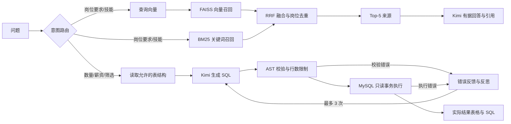

# 职向 · 基于 RAG 的智能就业分析助手

复用 `bossinfo.jobinfo` 招聘数据，提供中文问答界面、岗位知识检索和自然语言统计查询。技术栈：FastAPI、MySQL、Kimi 兼容 Chat Completions 接口、FAISS、BM25、SQLGlot。

## 快速启动（Windows / PowerShell）

```powershell
python -m venv .venv
.\.venv\Scripts\python.exe -m pip install -e ".[dev]"
Copy-Item .env.example .env  # 仅首次配置；已有 .env 不要覆盖
# 编辑 .env，填写 MYSQL_PASSWORD
.\.venv\Scripts\python.exe -m app.cli check-db
.\.venv\Scripts\python.exe -m app.cli build-index
.\start.ps1
```

访问 http://127.0.0.1:8000；交互式 API 文档 http://127.0.0.1:8000/docs。

若 PowerShell 执行策略不允许脚本，可直接运行：

```powershell
.\.venv\Scripts\python.exe -m uvicorn app.main:app --host 127.0.0.1 --port 8000
```

已有本地 `.env` 已配置用户提供的数据库连接，密钥文件及索引不纳入版本管理。应用只执行查询，不修改爬虫数据库或建立 SQL 视图。

本工作区已安装依赖并下载中文模型至 `data/models/bge-small-zh-v1.5`，本地 `.env` 已使用真实语义模式，现有索引包含 6,403 条岗位。直接运行 `start.ps1` 即可；尚需自行填写 Kimi 密钥与模型 ID。运行验证记录见 [docs/verification.md](docs/verification.md)。

## 接入 Kimi

在 `.env` 中填写：

```dotenv
KIMI_API_KEY=你的密钥
KIMI_BASE_URL=https://api.moonshot.cn/v1
KIMI_MODEL=你的账号实际可用的模型ID
```

修改配置后重启服务。模型名称由实际 API 服务决定，不硬编码或假设 `Kimi k3` 是可调用的 ID。使用中转服务时设置对应的根地址（通常以 `/v1` 结尾）。密钥仅由服务端读取，不发送到页面。API 可能按调用计费。

未配置模型时，默认启用明确标记的演示模式：RAG 返回来源摘录；SQL 仅执行有限的参数化模板，不执行模型生成或反思纠错。模板示例：

- 北京 Python 岗平均薪资
- Java 岗位数量
- 招聘岗位的城市分布

更复杂的条件（学历、经验、公司、组合城市等）请配置 Kimi。`ALLOW_DEMO=false` 可禁用演示回退。

## 真实语义向量

本地中文模型：

```powershell
.\.venv\Scripts\python.exe -m pip install -e ".[semantic]"
```

```dotenv
EMBEDDING_PROVIDER=sentence_transformers
EMBEDDING_MODEL=BAAI/bge-small-zh-v1.5
```

首次使用需要下载模型。也可以把 `EMBEDDING_MODEL` 设置为已下载模型的本地目录。或者接入独立的 Embedding API：

```dotenv
EMBEDDING_PROVIDER=api
EMBEDDING_BASE_URL=https://your-embedding-provider.example/v1
EMBEDDING_API_KEY=你的Embedding密钥
EMBEDDING_MODEL=服务商实际支持的Embedding模型ID
```

Kimi 聊天服务不一定提供 Embedding 接口，两者分别配置。`.env.example` 默认 `EMBEDDING_PROVIDER=hash` 方便离线试跑；hash 是稳定分词哈希词面向量，**不具备语义理解，不能作为语义检索效果证明**。切换模型、服务地址或向量参数后，重建索引并重启服务。

`requirements.lock.txt` 记录本次 Windows / Python 3.9 环境通过验证的完整依赖版本（含本地语义模型组件）。需要复现时先安装该文件，再运行 `pip install -e .`；模型权重不包含在依赖锁文件中。

## 处理链路



路由先使用规则判断明确意图，模糊问题再交给模型分类；支持手动指定 `rag` / `sql`。当前每次提问独立处理，不把页面中的历史对话自动作为后续查询条件。

检索文档从岗位名称、技能标签、学历、经验、公司、城市等字段构建。短文保持完整；长文按句子拆分，通过相邻句向量余弦相似度及最大长度确定分块边界。两路各召回最多 30 条，以 `1/(60+rank)` 做 RRF 排名，按岗位 ID 去重，返回最多 5 条依据；相关候选不足时不强行补齐。向量按 L2 归一化，FAISS `IndexFlatIP` 实现精确余弦检索。结果分数是 RRF 分值，不能解释为置信度。

索引采用不可变版本目录和原子指针切换，重建期间继续使用旧索引。爬虫入库不会自动更新向量库，请从页面或 CLI 手动重建。当前设计用于单进程服务；多 worker 部署需要统一索引任务协调与重新加载机制。

## 数据字段与统计口径

实际 `jobinfo` 没有完整岗位描述字段，技能与要求主要来自 `workTag`、`educational`、`workExperience`，不能声称索引了完整 JD。若后续爬虫增加岗位描述，应扩展 `app/rag.py` 的文档构造函数。

| 字段 | 含义 |
| --- | --- |
| title / type | 岗位名称 / 类别 |
| address / dist | 城市 / 区县 |
| workTag | 技能标签 JSON；兼容二次 Unicode 转义 |
| educational / workExperience | 学历 / 工作经验 |
| salary | 字符串 JSON 薪资区间，如 `[7000,12000]` |
| salaryMonth | 原始发薪月数字段，可能为 `0`，不计入月薪统计 |
| companyTitle / companyNature | 公司名称 / 行业 |
| createTime | 爬虫记录日期，不等同于实时招聘状态 |

平均月薪 = 有效区间 `(最低薪资 + 最高薪资) / 2` 的算术平均，单位元/月，跳过非法、倒置、负数区间。不是员工实际工资，不代表实时全市场。数据概览显示日期范围及有效薪资样本数。

## SQL 执行边界

- 解析 SQL AST，只允许单条 SELECT，只能访问 `jobinfo` 及允许的岗位字段；禁止 `SELECT *`、账户与 HR 字段、跨库、系统表、变量、文件操作及危险函数。
- 禁止 JOIN、CTE、UNION、写入、锁定和注释；聚合、筛选、分组和普通子查询可用。
- 使用只读事务、默认 5 秒数据库查询超时、最多 100 行、最多 3 次纠错。
- SQL 校验不能替代数据库权限管理；正式部署应使用仅具有 `bossinfo.jobinfo` SELECT 权限的独立账号。项目不会自动创建账号。
- 如需对外提供服务，设置 `SERVICE_API_KEY`；客户端使用 `X-API-Key` 请求头。默认启动只监听本机。

## API

| 方法与路径 | 用途 |
| --- | --- |
| GET /api/health | 数据库、模型配置、索引与构建状态 |
| GET /api/overview | 样本统计、热门城市、岗位类别 |
| GET /api/schema | SQL Agent 允许使用的表结构 |
| POST /api/chat | 问答，返回路由、结果、SQL、执行尝试和来源 |
| POST /api/index/rebuild | 异步重建索引；重复任务返回 409 |

请求示例：

```json
{"question":"北京 Python 岗平均薪资","mode":"auto"}
```

`mode` 可取 `auto`、`rag`、`sql`；响应中的 `mode` 表示 `demo` 或 `live`。索引与模型问题返回明确错误；模型调用失败不会偷偷回退为成功的模板结果。`/api/health` 中模型状态仅检查配置完整性，真实可调用性需要实际问答验证。

## 验证与目录

```powershell
.\.venv\Scripts\python.exe -m pytest -q
node --check app/static/app.js
```

测试覆盖 SQL 危险语句拦截、薪资解析、执行报错修正、重试边界、混合检索、索引重载、语义断点、意图路由和 API 校验。测试中的模型调用使用替身，不消耗真实 API。

```text
app/
  main.py          FastAPI 路由及索引后台任务
  config.py        环境配置
  database.py      MySQL 只读访问和薪资口径
  llm.py           Kimi 接口
  embeddings.py    本地 / API / 演示 Embedding
  rag.py           文档、分块、FAISS、BM25、引用回答
  router.py        意图路由
  sql_agent.py     SQL 生成、校验、执行、反思
  cli.py           数据检查和索引构建命令
  static/          中文问答界面
tests/             自动化测试
start.ps1          Windows 启动入口
```
